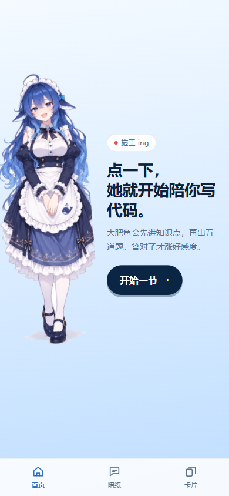
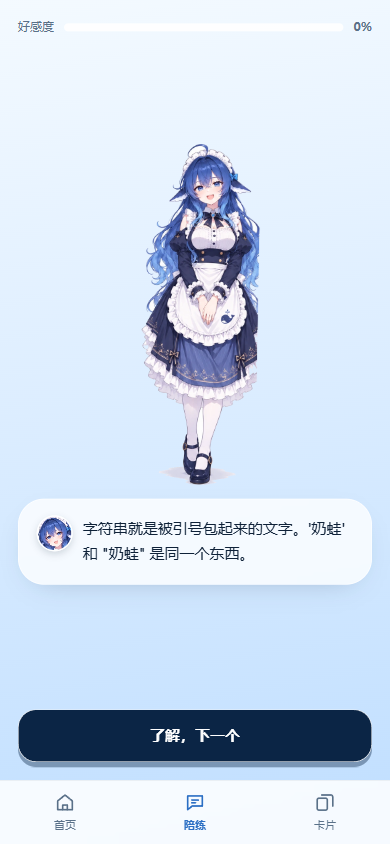
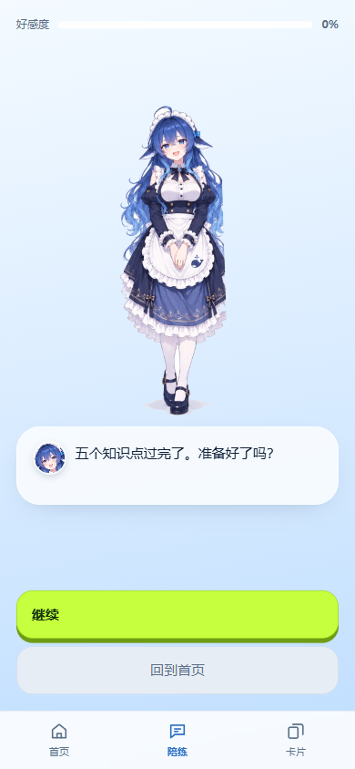
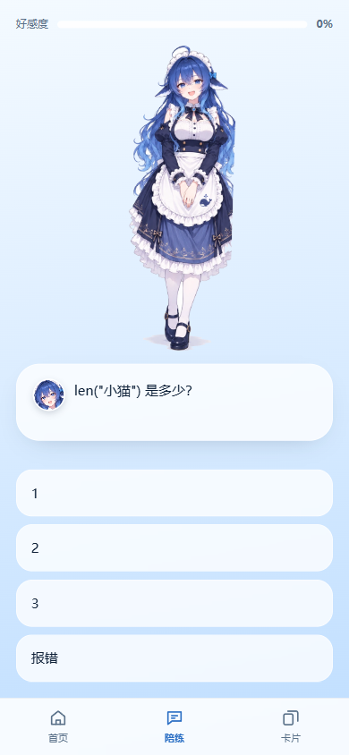
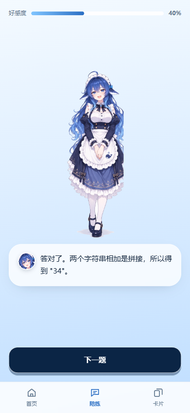
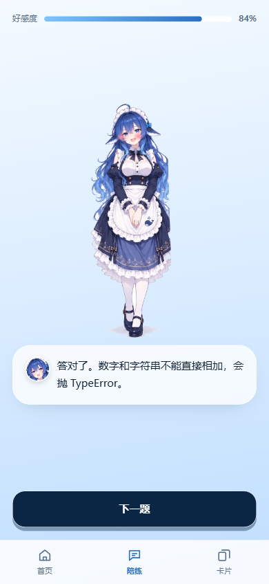
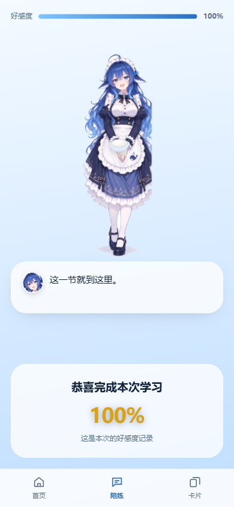
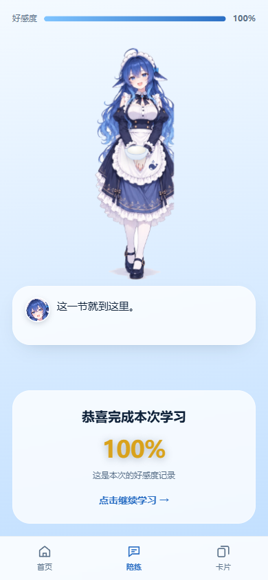
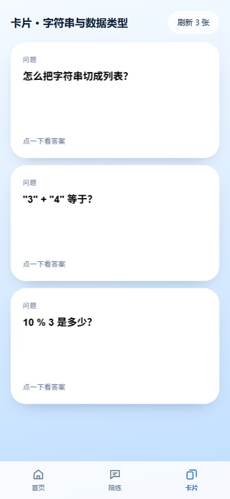
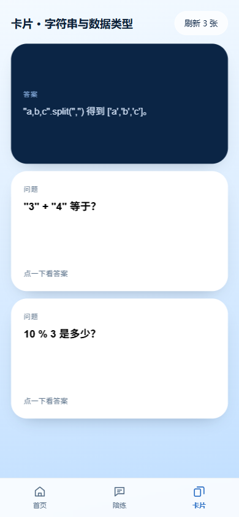

# wide whale · code learning Galgame

> **本分支新增 Whale Studio 移动 IDE 前端。** 打开 [`ide.html`](ide.html)，或使用 [`docs/ide-preview.html`](docs/ide-preview.html) 查看手机视口。支持左右滑动的文件 / 编辑器与终端 / AI 助手与知识卡片三个工作区；详见 [功能与运行说明](docs/mobile-ide.md)。根入口现跳转至 IDE，原有 `mobile.html` 学习页面保留。下文为原学习页面说明。

> **Android 离线安装版：** [构建与安装说明](docs/android.md)。运行 `scripts/build_android.ps1` 生成可侧载的签名预览 APK；离线前端、浏览器分享包与 APK 使用同一份界面代码。AI 与终端仍为演示功能。

> 给**第一次写代码就卡住的大一新生**，做一个会陪着的编程入门网页。
> 卡住了有人讲，答对了才涨好感度 —— 把"陪伴"绑在"学会"上，而不是绑在"聊得久"上。

**当前状态：移动端可交互草稿（单文件、零依赖、纯前端）。** 教学内容和立绘都还是占位，用来验证交互与节奏。

---

## 目录

- [一句话定位](#一句话定位)
- [它不是什么样的产品](#它不是什么样的产品)
- [三个阶段（含截图）](#三个阶段含截图)
- [好感度规则](#好感度规则)
- [技术底牌](#技术底牌)
- [运行](#运行)
- [怎么改内容](#怎么改内容)
- [已知取舍与待办](#已知取舍与待办)
- [目录结构](#目录结构)

---

## 一句话定位

大一新生第一次写代码，卡住的时候不是"不会写"，是**不知道该问谁**：问老师怕蠢，搜报错看不懂，问同学怕烦人。

所以这里放一个不会烦你的东西。它的全部设计围绕一个约束：**好感度只因为答对而涨**。

## 它不是什么样的产品

| 不是 | 因为 |
|---|---|
| 不是聊天机器人 | 没有自由输入框，全程点选项。手机打字慢，选项是主路 |
| 不是刷题网站 | 每个知识点先讲、再确认、再考，考完给一个「好感度」 |
| 不是 AI 出题器 | **判题不交给模型**。对错由本地题库决定，模型只负责讲"为什么" |

最后这条是产品能不能立住的关键：模型会胡说，但它说错一个选项的成本，比说错一段解释高得多。把不可靠的东西关在门外，比让它更可靠便宜得多。

---

## 三个阶段（含截图）

底部导航从五个减到三个：**首页 / 陪练 / 卡片**。一进来先看到首页。

### 0. 首页



- 角色占左侧，身体微倾表示"邀请"，右侧是一列文字 + 一个动作按钮。
- 渐变的浅蓝背景，从上到下略微加深，让白色卡片浮得出来。
- 右边那个 `施工 ing` 胶囊是**故意的**——这是个草稿，别让评委以为这是完成品。
- 在电脑上打开（宽度 > 600px）时，内容会收成一条 430px 的手机列居中，不会拉满整屏。

### 1. 陪练 · 知识点阶段



- 先给知识点，**用户只要点「了解，下一个」**，一共 5 次。
- 这一段没有任何"考核"，目的是让用户先建立"这里说是安全的"的感觉。
- 顶部是常驻的好感度条，全程可见——它是个进度条，也是个"承诺"。

### 2. 陪练 · 准备好了吗



- 五个知识点过完，才问「准备好了吗」。
- 下面两个选项：**荧光绿的「继续」** 和 **灰色的「回到首页」**。
- 荧光色只给主路，灰色只给退路——颜色本身就是层级。回到首页不会丢进度。

### 3. 陪练 · 第 1 题



- 四选一，点一下立刻出结果。
- 答对：好感度 +20%，并给一句"对在哪"。
- 答错：**好感度不动**（第一次错不扣），给一句"错在哪"。

### 4. 陪练 · 答题进行中



- 这时候好感度 40%，顶部进度条同步。
- 答对的那一秒，角色会蹦一下（带压扁-拉伸的挤压感），开心时腮红 + 爱心往上飘。

### 5. 陪练 · 后段



- 连对三道会额外奖励，连错两道才会扣分——**惩罚比奖励晚来**，这是刻意的：
  前两道错的时候用户最沮丧，这时候扣分等于把人赶走。

### 6. 结束 · 捧白米饭（好感度 > 85%）



- 好感度超过 85%，角色会**先鞠一下身再把一碗白米饭递出来**——比"碗突然出现"可信。
- 好感度数字按分数变色：**> 90% 金色**、**< 30% 红色**、其他白色。
- 低于 30% 换成叉腰生气，中间档换成打招呼；三种情况都会显示「恭喜完成本次学习」。
- 上面那张是 100% 全对的样子。

### 7. 结束 · 三秒后出现「点击继续学习」



- 「恭喜完成本次学习」先出现，**三秒后**底部才浮出「点击继续学习」。
- 这个延迟是为了让"看结果"和"再学一次"变成两个动作，不是一次点击就滑走。
- 因为内容还没做好，这里就是重复同一节。

### 8. 卡片 · 一次三张



- 知识点范围限定在 **Python 的字符串与数据类型**，一共 **20 张**卡轮换。
- 一次只展示 **3 张**，顶部「刷新 3 张」保证换出**跟当前完全不同的三张**（不是随机碰运气）。

### 9. 卡片 · 翻面看答案



- 点卡片翻面，正面是问题，背面是答案加一句"为什么"。
- 用 `transform-style: preserve-3d` + `backface-visibility: hidden`，两个面是同一张卡的两侧，不是两张图切换。
- 用 `<button>` 做卡片，键盘 Tab + Enter 也能翻。

---

## 好感度规则

五道题平分 100%，**每题 20%**。

| 情况 | 变化 | 说明 |
|---|---|---|
| 答对 | `+20` | `BOND_STEP = 20` |
| **连对第三道** | `+20，再 +2` | 额外 +10% 本题分（`CHAIN_BONUS = 0.1`），并触发蹦跳 + 脸红 |
| 答错（第一道） | `不变` | 只讲解，不惩罚 |
| **连错第二道** | `当前好感度 × 0.8` | 扣 20%（`CHAIN_PENALTY = 0.2`），并触发跺脚生气 |
| 结算 > 85% | 捧白米饭 | 金色（> 90% / 红色 < 30% / 其余白色） |
| 结算 < 30% | 叉腰生气 | |
| 其余 | 打招呼 | |

> ⚠️ 一个已知的设计漏洞：**5 题 × 20%，答对 4 题只有 84%**，差 1% 拿不到"捧饭"和金色。也就是说现在只有 5/5 全对才能看到最高档，中间没有过渡带。
> 两条修法，任选一条：把门槛降到 ≥ 80；或者每题改成 25%。

全对时的实际曲线：`20 → 40 → 62 → 84 → 100`（第三题因为连对额外 +2）。

---

## 技术底牌

| 项 | 选择 | 为什么 |
|---|---|---|
| 框架 | **零** | 一个 `mobile.html`，双击就能开，不需要装任何东西 |
| 图片 | **内联 base64 WebP** | 立绘 728KB PNG 压成 123KB，转成 data URI 嵌在 HTML 里。文件拷到哪都能显示，不会出现"破图" |
| 路由 | `#/home` `#/learn` `#/cards` | 用 hash 而不是真路径，本地双击 `file://` 打开也不会 404 |
| 动画 | 纯 CSS keyframes | 没有动画库。开心=压扁-拉伸的蹦跳，生气=跺脚抖，捧饭=先鞠躬再递碗 |
| 尺寸 | `100dvh` + `env(safe-area-inset-*)` | 手机上不会出现 iOS 地址栏导致的高度跳变，也不被刘海挡 |
| 数据 | 三个数组 | 知识点、题目、卡片全是纯数据，改内容不用碰逻辑 |

**一处值得单独说的：** 情绪的"动作"不是靠叠图层的。比如开心，是一次完整的起跳——先 `scale(1.06, .92)` 压下去，再 `translateY(-34px) scale(.97, 1.05)` 拉起来，落地回弹。只做平移会像"一张图在挪动"，加了挤压才有重量感。

---

## 运行

**最简单：** 双击 `mobile.html`。

**或者起个本地服务**（推荐，手机上也能看）：

```bash
# 在这个目录下
py -m http.server 8767 --bind 127.0.0.1
# 然后浏览器打开 http://127.0.0.1:8767/mobile.html
```

> Windows 上如果 `python` 指向的是 Python 2.7（很多机器上是），请用 `py` 而不是 `python`。

---

## 怎么改内容

全部内容集中在 `<script>` 开头的三个数组里，**改这里不用碰任何逻辑**：

```js
// 5 个知识点：只需要一句话
const KP = [ "字符串就是被引号包起来的文字……", ... ];

// 5 道题：q 题干、opts 选项、ans 正确选项下标（从 0 起）、why 讲解
const QS = [ { q: "...", opts: ["1","2","3","报错"], ans: 1, why: "..." }, ... ];

// 20 张卡片：[正面问题, 背面答案]
const CARDS = [ ["单引号和双引号有区别吗？", "没有。'a' 和 \"a\" 是同一个字符串。"], ... ];
```

调难度改四行常数：

```js
const BOND_STEP     = 20;   // 每题基础分
const CHAIN_BONUS   = 0.1;  // 连对第三道的额外奖励（本题分的 10%）
const CHAIN_PENALTY = 0.2;  // 连错第二道扣当前好感度 20%
```

改表情/动作改 CSS 里 `[data-mood="..."]` 那几行的角度和位移数字。

---

## 已知取舍与待办

**取舍（故意没做）**

- 没有自由输入框 —— 手机打字慢，选项是主路。
- 没有接真模型 —— 数据都是本地 mock，先把交互和节奏跑通。
- 判题不交给模型 —— 对错是本地题库说了算，模型只负责讲"为什么"。

**待办**

- [ ] 接一个后端代理（国内大厂的 LLM API 基本不发 CORS 头，浏览器直连必失败，**代理是必需品不是可选项**）
- [ ] 4 张表情差分立绘，替换现在"叠腮红 + 蹦跳"的做法
- [ ] 「挥手」「叉腰」「一手前伸邀请」需要手臂在不同位置的立绘，一张双手合十站立的图做不出来
- [ ] 好感度门槛的过渡带（见上面的漏洞）
- [ ] 学习记录持久化（现在刷新就重置）

---

## 目录结构

```
.
├── mobile.html                      # 全部实现，单文件
├── README.md
├── .gitignore
└── docs/
    └── screenshots/                 # README 里用到的 10 张阶段截图
        ├── 01-home.png
        ├── 02-knowledge.png
        ├── 03-ready.png
        ├── 04-question-1.png
        ├── 05-quiz-progress.png
        ├── 06-quiz-late.png
        ├── 07-finish-gold.png
        ├── 08-finish-more.png
        ├── 09-cards.png
        └── 10-cards-answer.png
```

---

## 说明

- 本仓库为公开仓库，请勿提交任何密钥、账号或私有素材。
- 单个文件上限 100MB，大素材请使用 Git LFS。
